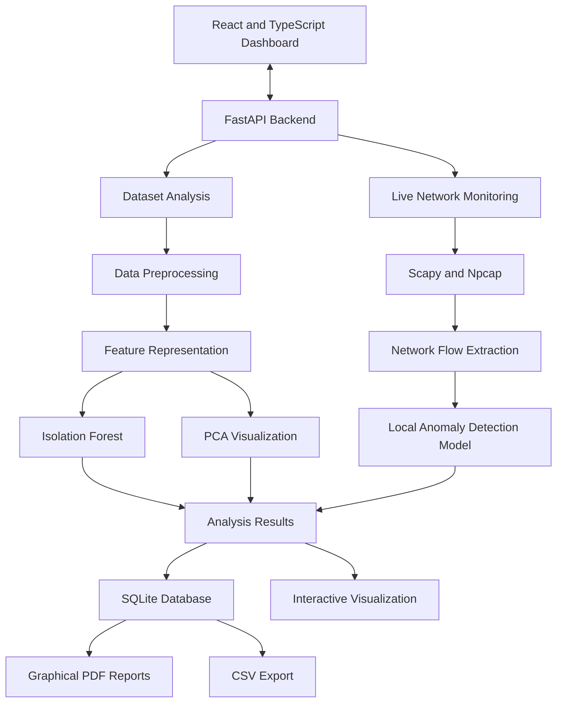
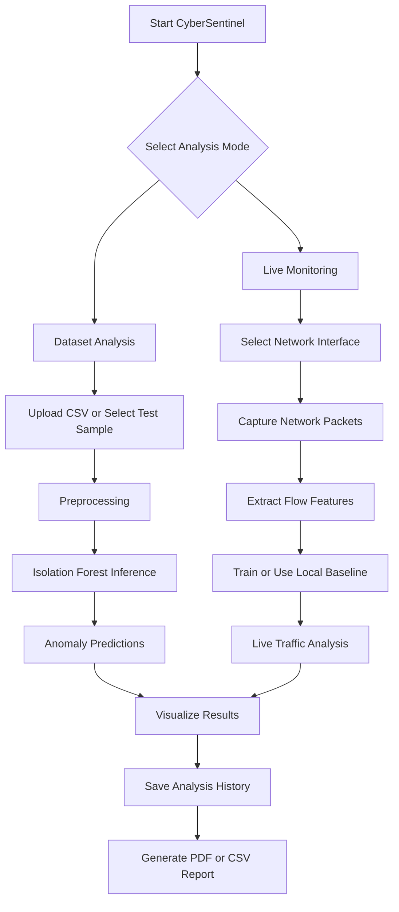

# 🛡️ CyberSentinel

### Network Anomaly Detection Using Unsupervised Machine Learning and Dimensionality Reduction


---

## 📌 Project Overview

**CyberSentinel** is a full-stack, machine learning-powered network anomaly detection and monitoring system designed to identify unusual network traffic patterns and assist cybersecurity analysis.

The application integrates Isolation Forest, Principal Component Analysis (PCA), statistical traffic analysis, live packet capture, interactive data visualization, persistent analysis history, and automated graphical report generation.

CyberSentinel provides a unified platform for investigating network behaviour using benchmark datasets and real network traffic metadata.

---

## 🎯 Objectives

- Detect anomalous network traffic using machine learning.
- Learn normal network behaviour through normal-only model training.
- Investigate the impact of dimensionality reduction on anomaly detection.
- Capture and monitor real network traffic.
- Visualize network patterns and anomalous observations.
- Provide data-driven network security recommendations.
- Maintain persistent analysis history.
- Generate downloadable graphical analysis reports.

---

## 🚀 Key Features

| Feature | Description |
|---|---|
| Machine Learning | Isolation Forest-based anomaly detection |
| Dimensionality Reduction | PCA-based feature transformation and visualization |
| Live Monitoring | Real network packet capture using Scapy and Npcap |
| Live Anomaly Screening | Separately trained local network-flow baseline |
| Traffic Analysis | Protocol distribution, packet counts and traffic rates |
| Security Insights | Anomaly scores and flagged network records |
| CSV Analysis | Upload and analyze compatible network datasets |
| Interactive Dashboard | Dynamic graphs and statistical visualizations |
| Optimization | Evidence-based network security recommendations |
| Analysis History | Persistent storage using SQLite |
| PDF Reports | Automated graphical network analysis reports |
| CSV Export | Downloadable record-level predictions |
| REST API | FastAPI-powered backend integration |

---

## 🏗️ System Architecture



---

## 🧠 Machine Learning Methodology

### 1. Dataset

The project utilizes the **UNSW-NB15 Network Intrusion Detection Dataset**, which contains normal network traffic and multiple categories of cyberattacks.

The dataset includes network characteristics such as:

- Network protocol
- Connection duration
- Service type
- Connection state
- Source and destination bytes
- Packet counts
- Traffic rates
- Statistical connection attributes

Dataset source:

https://research.unsw.edu.au/projects/unsw-nb15-dataset

### 2. Data Preprocessing

The preprocessing pipeline consists of:

- Missing-value handling
- Median imputation
- Numerical feature extraction
- StandardScaler normalization
- One-hot encoding
- Removal of target labels and identifiers from predictor features
- Separation of training, validation and testing records

### 3. Isolation Forest

Isolation Forest is a machine learning algorithm that identifies anomalous observations by isolating them through randomized tree structures.

Unusual observations generally require fewer tree partitions to become isolated.

CyberSentinel trains its selected detector exclusively on normal network traffic and evaluates deviations from learned behavioural patterns.

The anomaly threshold is calibrated using a separate labelled validation dataset.

The overall methodology is therefore a semi-supervised novelty detection approach using an unsupervised anomaly detection algorithm.

### 4. Principal Component Analysis (PCA)

Principal Component Analysis is implemented to investigate dimensionality reduction and visualize high-dimensional network traffic.

| Configuration | Dimensions |
|---|---:|
| Encoded feature space | 58 |
| PCA with 95% explained variance | 23 |
| PCA with 99% explained variance | 31 |

Four feature representations were experimentally evaluated:

- Full encoded feature space
- Numerical features only
- PCA retaining 95% variance
- PCA retaining 99% variance

The numerical-feature Isolation Forest achieved the highest validation F1-score and was selected as the active dataset detector.

PCA remains part of the comparative methodology and two-dimensional traffic visualization.

---

## 📊 Experimental Results

### Training Configuration

| Parameter | Value |
|---|---:|
| Normal training records | 6,000 |
| Validation records | 3,000 |
| Testing records | 5,000 |
| Isolation Forest estimators | 160 |
| Selected feature representation | Numerical features |
| Random seed | 42 |
| Maximum validation false-positive rate | 15% |

### Model Performance

| Evaluation Metric | Result |
|---|---:|
| Accuracy | 61.56% |
| Precision | 73.75% |
| Recall | 47.91% |
| F1-Score | 58.09% |
| F2-Score | 51.52% |
| Balanced Accuracy | 63.28% |
| ROC-AUC | 0.7613 |
| PR-AUC (Average Precision) | 0.7689 |
| Matthews Correlation Coefficient | 0.2748 |
| Test False-Positive Rate | 21.35% |

### Performance Visualization

```text
Accuracy      ████████████░░░░░░░░  61.56%
Precision     ███████████████░░░░░  73.75%
Recall        ██████████░░░░░░░░░░  47.91%
F1-Score      ████████████░░░░░░░░  58.09%
ROC-AUC       ███████████████░░░░░  76.13%
```

### Confusion Matrix

| Actual / Predicted | Normal | Anomaly |
|---|---:|---:|
| Normal | 1746 | 474 |
| Attack | 1448 | 1332 |

- True Positives: 1,332
- True Negatives: 1,746
- False Positives: 474
- False Negatives: 1,448
- Total records analyzed: 5,000

The results demonstrate useful anomaly-ranking capability, although further improvements are required to reduce false positives and missed attacks.

---

## 🌐 Live Network Monitoring

CyberSentinel integrates real network packet capture through **Scapy and Npcap**.

Npcap provides the underlying packet-capture infrastructure on Windows, while Scapy provides the Python interface for packet capture and protocol inspection.


The live monitoring module captures and processes:

- Source and destination IP addresses
- Source and destination ports
- TCP, UDP, ICMP and ARP traffic
- Packet counts
- Transferred bytes
- Network flow duration
- Average packet rates
- Average data transfer rates
- Recent traffic activity
- Live-flow anomaly scores

The application uses a separate locally trained anomaly-detection baseline for live network flows because the captured feature representation differs from the UNSW-NB15 dataset.

Packet payloads are not retained by the application.

---

## 🖥️ Application Modules

### Overview

Displays model performance, network traffic statistics, and anomaly detection insights.

### Security Insights

Displays flagged network records and their anomaly scores for further investigation.

### Traffic Analysis

Visualizes protocol distribution and sample network traffic patterns.

### Optimization

Provides recommendations based on measured detection performance and network observations.

### Analyze Traffic

Supports CSV upload, machine learning inference, PCA visualization, confusion matrices and record-level predictions.

### Real Dataset Lab

Displays training configurations, evaluation metrics and experimental results.

### Live Monitoring

Captures real network packets and displays traffic activity, protocol distributions, network flows and local anomaly screening.

### Analysis History

Stores dataset analysis and live monitoring sessions in SQLite for later retrieval.

---

## 📑 Automated Report Generation

CyberSentinel generates downloadable graphical PDF reports containing:

- Analysis summary
- Network traffic statistics
- Protocol distribution graphs
- Traffic activity graphs
- PCA scatter plots
- Anomaly score distributions
- Model evaluation metrics
- Confusion matrices
- Top network flows
- Interpretation and limitations

The report contents depend on whether the saved analysis is a dataset experiment or a live monitoring session.

Users can also export predictions and captured flow summaries in CSV format.

---

## ⚙️ Technology Stack

| Category | Technologies |
|---|---|
| Frontend | React, TypeScript, Vite |
| Backend | Python, FastAPI, Uvicorn |
| Machine Learning | Scikit-learn, Isolation Forest, PCA |
| Data Processing | Pandas, NumPy |
| Network Capture | Scapy, Npcap |
| Database | SQLite |
| Visualization | Recharts, Matplotlib |
| Report Generation | ReportLab |
| Model Serialization | Joblib |
| Development Environment | Visual Studio Code |
| Version Control | Git, GitHub |

---

## 📂 Project Structure

```text
CyberSentinel/
│
├── backend/
│   ├── app/
│   │   ├── analysis/
│   │   ├── api/
│   │   ├── capture/
│   │   │   ├── packet_capture.py
│   │   │   ├── flow_extractor.py
│   │   │   └── live_ml.py
│   │   ├── database/
│   │   ├── ml/
│   │   ├── preprocessing/
│   │   ├── config.py
│   │   └── main.py
│   ├── tests/
│   └── requirements.txt
│
├── frontend/
│   ├── public/
│   ├── src/
│   │   ├── assets/
│   │   ├── components/
│   │   ├── pages/
│   │   ├── services/
│   │   ├── App.tsx
│   │   └── main.tsx
│   ├── package.json
│   └── vite.config.ts
│
├── models/
│   ├── unsw_nb15_v2_pipeline.joblib
│   └── unsw_nb15_v2_report.json
│
├── scripts/
│   ├── preprocess.py
│   ├── train.py
│   ├── train_unsw.py
│   ├── train_unsw_v2.py
│   └── check_v2_integration.py
│
├── .gitignore
└── README.md
```

---

## 🔧 Installation and Setup

### Prerequisites

- Python
- Node.js and npm
- Git
- Npcap for Windows live network monitoring

Npcap can be downloaded from:

https://npcap.com/#download

### Clone the Repository

```bash
git clone https://github.com/Annwesh02-rip/CYBERSENITAL.git
cd CYBERSENITAL
```

### Backend Setup

Create a Python virtual environment:

```powershell
python -m venv .venv
```

Activate the virtual environment:

```powershell
.\.venv\Scripts\Activate.ps1
```

Install the required dependencies:

```powershell
pip install -r backend/requirements.txt
```

### Dataset Setup

Download the UNSW-NB15 training and testing CSV files from the official dataset source.

Place the files in the following directory:

```text
datasets/
└── raw/
    ├── UNSW_NB15_training-set.csv
    └── UNSW_NB15_testing-set.csv
```

The original datasets are not included in this repository.

### Model Training (Optional)

A trained dataset model is included in the repository.

To reproduce the current training configuration:

```powershell
python scripts/train_unsw_v2.py --normal-rows 6000 --validation-rows 3000 --test-rows 5000
```

Use compatible Python and scikit-learn versions when loading the serialized model, or retrain it locally.

### Start the Backend

```powershell
cd backend
python -m uvicorn app.main:app --host 127.0.0.1 --port 8000
```

Backend:

http://localhost:8000

Interactive API documentation:

http://localhost:8000/docs

### Start the Frontend

Open a separate terminal from the project root.

```powershell
cd frontend
npm install
npm run dev
```

Application:

http://localhost:5173

---

## 🔄 Application Workflow



---

## 🧪 Testing and Validation

The project includes tests and integration checks for:

- Backend API functionality
- Data preprocessing
- Machine learning inference
- SQLite history storage
- Packet flow aggregation
- Graphical PDF generation
- CSV report generation
- Frontend production build

Run the backend integration check while the backend server is active:

```powershell
python scripts/check_v2_integration.py
```

Run the backend tests:

```powershell
python -m pytest backend/tests -v
```

Verify the frontend production build:

```powershell
cd frontend
npm run build
```

---

## 💡 Project Contributions

- Normal-only anomaly detector training.
- Validation-based anomaly threshold calibration.
- Comparative evaluation of different feature representations.
- Integration of machine learning with live network monitoring.
- Interactive PCA-based traffic visualization.
- Unified dataset analysis and network monitoring platform.
- Persistent analysis history and automated graphical reporting.
- Evidence-based network security decision support.

---

## 🔮 Future Scope

- Advanced anomaly detection using deep autoencoders.
- Hybrid machine learning architectures.
- Adaptive anomaly threshold optimization.
- Improved attack detection recall.
- Reduction of false-positive alerts.
- Automated attack-category classification.
- Distributed network monitoring.
- Advanced network congestion analysis.
- Cloud-based deployment.
- Integration with enterprise cybersecurity platforms.

---

## ⚠️ Disclaimer

CyberSentinel is developed for academic, educational and research purposes.

Anomaly predictions indicate deviations from learned network behaviour and do not necessarily establish malicious activity.

The application is a research prototype and is not intended to replace production-grade intrusion detection or prevention systems.

Live network monitoring must only be performed on authorized network interfaces.

Raw datasets, private network capture records, local databases and locally trained live baselines are excluded from this repository.

---

## 👨‍💻 Developer

**Annwesh Hazra**

GitHub: [Annwesh02-rip](https://github.com/Annwesh02-rip)

---

<div align="center">

### 🛡️ CyberSentinel

**Monitor. Detect. Analyze. Protect.**

*Machine Learning Meets Network Security.*

⭐ Star this repository if you find the project interesting.

</div>
